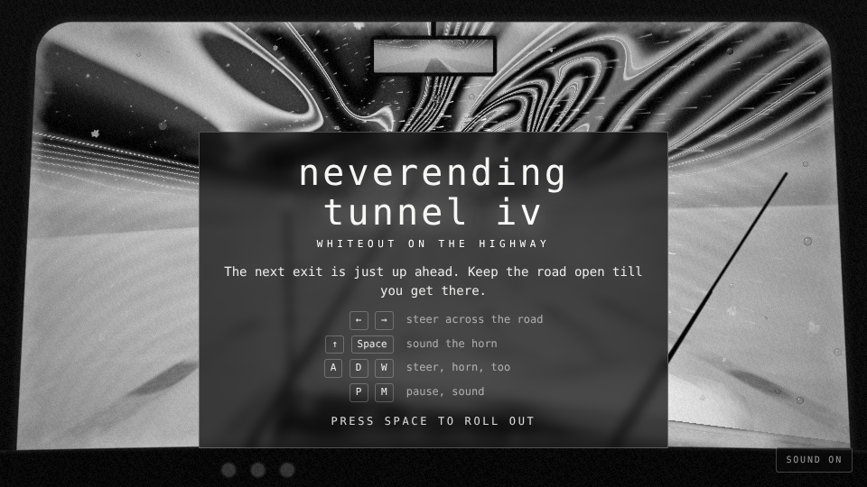
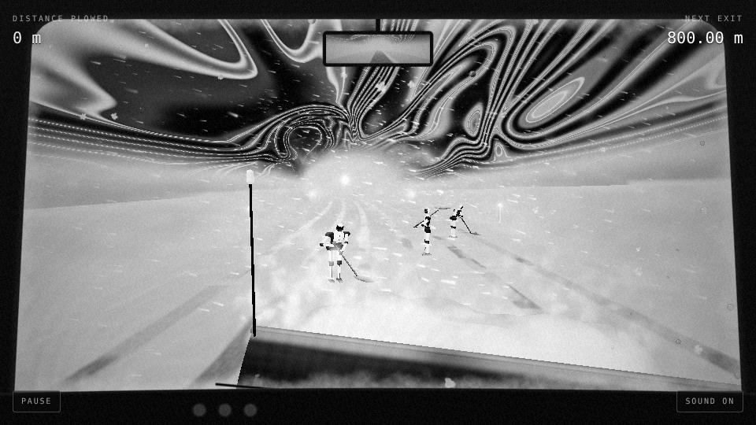
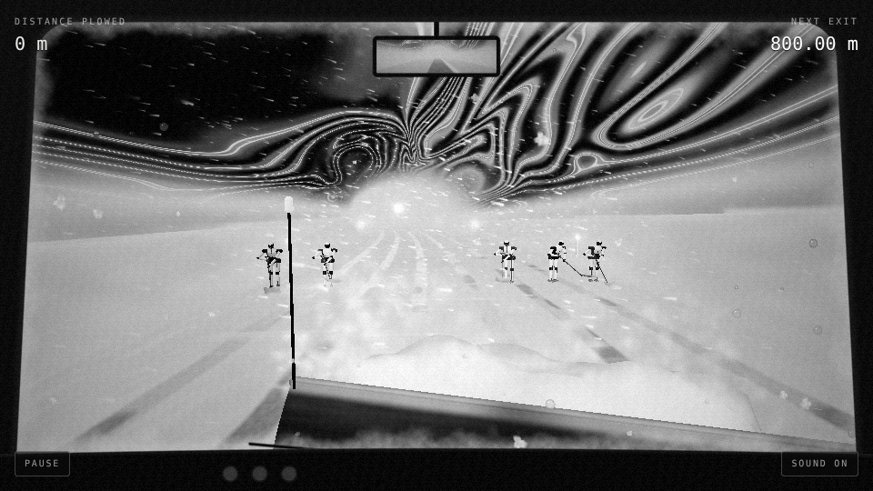
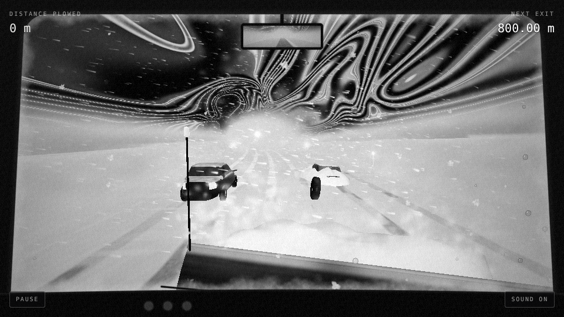
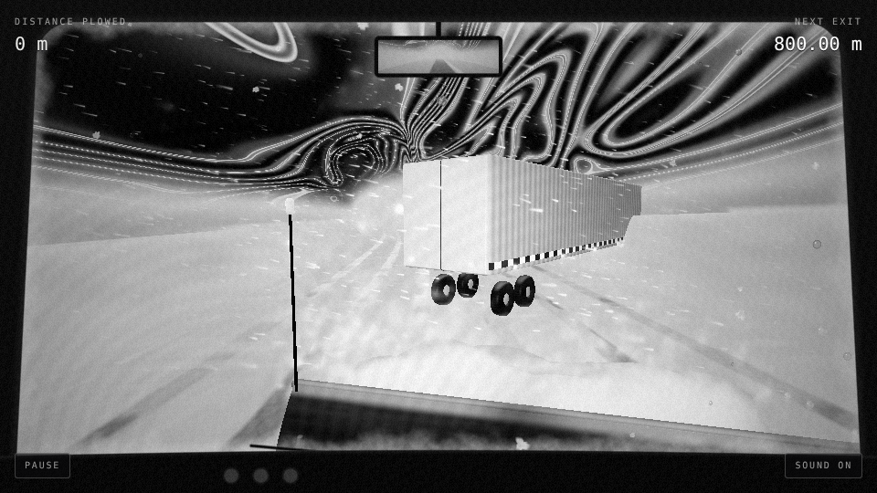
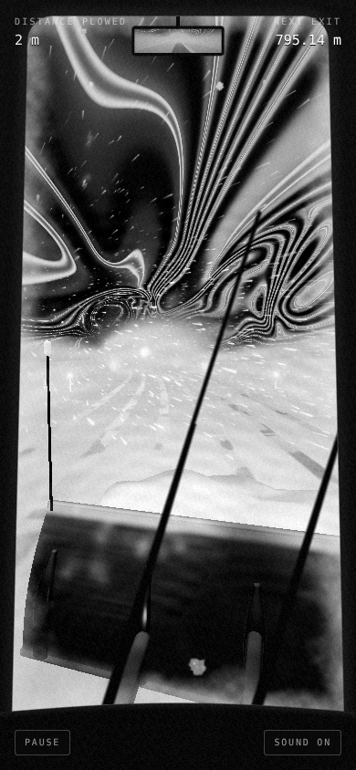

# Neverending Tunnel IV: Whiteout on the Highway

Plow an endless highway through a whiteout, round the robots shovelling
it and the cars stuck on it, towards the next exit. The exit is always
just up ahead. You never reach it.

The tunnel is a storm now. You drive a cab-over snowplow down a road
between snowbanks, the blizzard streaming at your windscreen, and
overhead the storm swirls like ink combed out on water, streaming out of
the white far ahead. It's all in black and white, from the driver's
seat: the blade below you throwing snow off to the right, the wipers
sweeping the flakes off the glass, frost creeping in at its edges, and
the road behind you in the mirror. Like Neverending Tunnel II and III
it's drawn with WebGPU where the browser has it and WebGL 2 where it
doesn't, with the same shaders written for each (WGSL in `src/shaders`,
GLSL in `src/shaders/gl`).



| | |
|---|---|
|  |  |
| Robots shovelling | A crew holding the line |
|  |  |
| A car, a buried car, a loose tire | A jackknifed semi |

On a phone it's the cab-over's tall windscreen:



## Run

```sh
npm install
npm run dev      # http://localhost:5173
npm run build    # static build in dist/
```

Needs WebGPU or WebGL 2 (any current browser). `?renderer=webgl` or
`?renderer=webgpu` pins one, and `?particles=40000` sets how much snow
there is (it otherwise starts at 70,000, or 30,000 on phones, and thins
itself out if frames run slow).

## Controls

- ← → / A D: steer across the road
- ↑ / W / Space: sound the horn
- Drag: steer, on a phone; tap or flick up: horn
- Space / tap: roll out, get back on the road
- P: pause, M: sound

## On the road

- Robots shovelling the road, bent over their shovels: honk and they hop out of the way
- Crews of robots right across the road, holding their line, with one gap
- Robots walking across with their shovels on their shoulders: honk and they run
- Robots leaping right across the road from the banks
- Cars crawling along with their hazards on, changing lanes
- Cars spinning out
- Cars buried in drifts, only their roofs showing
- A semi jackknifed across the road, with a gap at one end
- Loose tires bouncing towards you
- Drifts: plow straight through them

Tail lights, hazards and reflectors glow through the snow before what
they're on comes out of it. Passing close is a near miss: you'll hear it
go by.

## Sound

All made as it plays, with Web Audio, no samples. The band plays the
game's song, "Whiteout on the Highway": hard, driving metal in D minor at
185 beats a minute, the guitars in drop D, the verses going D, B flat, A,
the choruses D, B flat, C. The vocal hook is sung by two lead guitars in
harmony a third apart, up to a belted high B flat and a long high E that
slides down to D. It opens on one held, bent high D; there's a half-time
bridge that lifts back up, and a solo of long bends and runs. The sound is
after the [Madness Engine](https://github.com/h1ddenpr0cess20/madness-engine)'s
band (Metroll's): the rhythm guitars a wall of detuned-saw power chords,
one rig hard left and one hard right a hair late, the mids pushed into a
hard clipper, the lows put back, the middle scooped; palm-muted, they're
darkened before the amp so they thud. The bass drives eighths and steps
into each change. The drums are a metal kit (the beater's click on the
kick, a cracking snare, toms, a china), driving eighths on the kick in the
choruses, double bass under the solo, a fill into every change. A dark
string pad hangs over the choruses. The band is scheduled a second ahead
on its own timer, so a slow frame can't make it stumble. When you crash,
it hits one last chord and the lead dives off the end of the whammy bar.
Under it all: the diesel changing gear, the blade scraping the road, the
blizzard howling round the cab, the air horn and the wipers.

## Layout

- `src/shaders/tube.wgsl`: the highway (road, banks, the wall of blowing snow and the storm), its whole mesh made up from the vertex index
- `src/shaders/particles.wgsl`: the blizzard and the snow thrown off the blade, every flake made up from its index, and the lamps glowing through them
- `src/shaders/things.wgsl`: robots, cars, the semi, tires, posts, drifts and your blade: what each part is made of, and the light on them
- `src/shaders/sky.wgsl`: the light at the end
- `src/shaders/post.wgsl`: black and white, grain, the windscreen (snow, frost, wipers), the cab and its mirror, flash and fade
- `src/shaders/gl/`: the same five for WebGL 2
- `src/gpu.js`, `src/gl.js`: the WebGPU and WebGL 2 renderers; `src/renderer.js` picks one
- `src/frame.js`: packs each frame's uniforms once for either renderer
- `src/game.js`: driving, steering, the horn, the things on the road, plowing, collisions and near misses
- `src/meshes.js`: robots, shovels, cars, tires, the blade and its marker rods, the snow off it and drifts, swept along splines and lofted through sections
- `src/main.js`: the frame loop
- `src/input.js`, `src/hud.js`, `src/sound.js`: controls, HUD, the band and the truck
- `src/constants.js`, `src/math.js`: shared numbers and helpers
